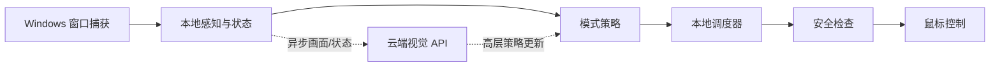

# Plants vs. Zombies Hybrid Edition 自动化

本项目面向 Windows 版《植物大战僵尸杂交版》v3.19。目前处于早期脚手架阶段，提供窗口截图探针、受保护的鼠标校准、坐标变换、Windows 下 F12 紧急停止、不可变状态模型，以及可配置的草坪网格几何辅助函数。示例截图位于 `data/screen_samples/sample-001.png`。

## 状态

这还不是完整的自动玩家。目前尚未实现自动草坪/对象识别、状态跟踪、云端 LLM API、冒险/无尽模式策略或持续游玩循环。当前示例截图中的识别边界也未经验证，Windows 实际截图和输入行为尚未验证。

## 架构

预期数据流如下。云端视觉 API 只异步更新高层策略；本地鼠标循环不等待 API，模型也不发送点击指令。点击由本地调度器生成并经过安全检查。



## Windows 启动

在 Windows 的命令提示符或 PowerShell 中进入 `pvz_auto` 目录，然后运行：

```bat
py -3.11 -m venv .venv
.venv\Scripts\activate
python -m pip install --upgrade pip
python -m pip install -e ".[test]"
```

安装 `.[test]` 会安装 pytest。只需使用探针和校准工具时，也可以运行 `python -m pip install -e .`。

## 截图探针

保持游戏窗口打开，在 `pvz_auto` 目录运行：

```bat
pvz-window-probe --contains "植物大战僵尸" --output data\screen_samples\capture.png
```

探针会列出匹配窗口，并且只捕获前台、未被遮挡的客户区。若没有匹配窗口，请将 `--contains` 的标题子串改为实际窗口标题。只查看匹配窗口列表、不保存截图时，省略 `--output`。

## 鼠标校准

先执行不点击的校准试运行：

```bat
pvz-mouse-calibrate --contains "植物大战僵尸" --x 200 --y 200
```

`x`、`y` 是相对于游戏客户区的像素坐标。只有在确认目标为空草坪位置后才进行单次真实点击：添加 `--click`，并在提示时准确输入 `CLICK`。倒计时期间可按 F12 中止。当前不要尝试批量或自动点击。

## 测试

安装了 `[test]` 可选依赖后，在 `pvz_auto` 目录运行：

```bat
python -m pytest
```

单元测试可在 Linux 上运行；窗口捕获和鼠标命令仅支持 Windows。

## 当前限制/下一步

接下来需要验证 Windows 窗口捕获和输入，再构建可靠的草坪与对象识别及状态跟踪，随后实现模式策略、本地调度器和安全受控的游玩循环。Adventure 与 Endless 的自动游玩目前都不受支持。
